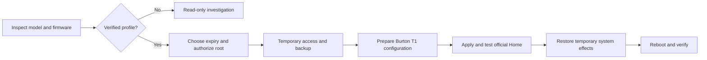

<div align="center">

# Fire TV Burton Activation

### Activate the new official Amazon Fire TV Home UI already inside your stock launcher

**Agent Skill • Claude Code & Codex • Assisted ADB workflow • Backup & recovery**

[Get started](#use-with-claude-code-or-codex) · [Compatibility](#verified-compatibility) · [Full workflow](skills/firetv-burton/references/workflow.md) · [Recovery](skills/firetv-burton/references/recovery.md) · [Italiano](README.it.md)


[](https://github.com/vage88sg1/firetv-burton-activation/actions/workflows/checks.yml)

</div>

The redesigned **Amazon Fire TV interface**, known as **Burton**, may already be
inside the official launcher while remaining disabled by device eligibility or
rollout controls. This project documents a verified way to activate that code
through its local configuration, with a portable skill that **Claude Code or
Codex** can follow.

**Observed result:** the new official Home UI rendered inside the original Amazon
launcher, remote navigation worked, and activation survived a reboot. The tested
device was a **first-generation Fire TV Stick 4K Max** running **Fire OS 7.7.1.3
PS7713/5443**. The method keeps the original APK and Amazon signature. It requires
temporary privileged access to the launcher's private configuration.

> **Check compatibility before proceeding.** This is an experimental workflow
> for devices you own. Its temporary-root step can hang or reboot the TV. One
> exact device/firmware profile has been verified; other profiles stay on the
> read-only investigation path.

## What is included

| Resource | Purpose |
| --- | --- |
| [Portable `firetv-burton` skill](skills/firetv-burton/SKILL.md) | Gives Claude/Codex the context, checks and operational sequence |
| [Complete operator workflow](skills/firetv-burton/references/workflow.md) | Covers ADB connection through final reboot, with verification gates |
| [Compatibility and evidence](skills/firetv-burton/references/compatibility.md) | Records what worked, what failed, and what remains unknown |
| [Python tools](skills/firetv-burton/scripts) | Inspect the device, prepare files offline and assist an authorized session |
| [Recovery and rollback](skills/firetv-burton/references/recovery.md) | Restore Home, OTA paths and the original system settings |
| [Declarative workflow](workflow.json) | Makes stages, prerequisites and stopping conditions readable to agents |
| [GitHub Actions checks](.github/workflows/checks.yml) | Run offline tests and public-tree checks without accessing a TV |

The packaged tools are extracted from the verified manual procedure and tested
offline. **They have not been separately qualified as a complete automatic
hardware installer.** No script or CI workflow starts the root exploit for you.

## Verified compatibility

| Device / software | Status |
| --- | --- |
| Fire TV Stick 4K Max 1st gen — **AFTKA / kara** | Tested |
| Fire OS **7.7.1.3**, **PS7713/5443** | Tested |
| Incremental build **0035334210436** | Required by the documented root path |
| Stock Amazon launcher **7280112.1**, version code **728011210** | Burton activated inside the original version |
| Other firmware, Fire TV Sticks, Fire TV Cube or integrated Fire TVs | Unverified; read-only investigation only |

“Fire OS 7” or “4K Max” alone is insufficient. The checks also consider the
exact build, kernel and architecture. The live workflow stops on a mismatch.

## Use with Claude Code or Codex

Clone the repository and open it in your local agent:

```sh
git clone https://github.com/vage88sg1/firetv-burton-activation.git
cd firetv-burton-activation
```

Then use this prompt, replacing the address privately:

```text
Read AGENTS.md and skills/firetv-burton/SKILL.md.
I want to activate the new official Amazon Burton Home UI on my own Fire TV.
Its ADB device address is TV_IP:5555. Start with read-only inspection.
Verify the exact profile, explain expiry and configuration-freeze choices,
and keep a backup before any changes. Do not repeat a live root attempt without
renewed informed authorization. Restore temporary system side effects and
verify Home after the final reboot.
```

The agent needs local ADB access to the TV's network. A cloud-only session or
GitHub Actions runner cannot automatically reach your Fire TV. Accept the TV's
ADB authorization dialog only for your own computer.

### Install the reusable skill

The skill folder is self-contained: instructions, references and scripts travel
together. From the repository root, copy it to your agent's skill directory.
Preserve an existing same-named skill instead of blindly overwriting it.

**Codex:**

```sh
mkdir -p ~/.agents/skills
cp -R skills/firetv-burton ~/.agents/skills/firetv-burton
```

Invoke **`$firetv-burton`**.

**Claude Code:**

```sh
mkdir -p ~/.claude/skills
cp -R skills/firetv-burton ~/.claude/skills/firetv-burton
```

Invoke **`/firetv-burton`**.

These locations follow the official
[Codex](https://developers.openai.com/codex/skills/) and
[Claude Code](https://code.claude.com/docs/en/skills) documentation.
No API key or project-specific MCP server is required.

## First check: no device modifications

With Python 3.9+ and Android Platform Tools installed:

```sh
adb connect TV_IP:5555
python3 skills/firetv-burton/scripts/burton.py inspect --device TV_IP:5555
```

The output shows whether the device matches the tested profile. This operation
does not obtain root, install applications or change settings. Continue through
the [full workflow](skills/firetv-burton/references/workflow.md); do not skip
straight to another project's root commands.

## How it works



The stock launcher contains both the UI and a local override mechanism for
Amazon experiments. The procedure changes device eligibility and the **T1**
treatment of the Burton experiment for the selected device. The APK retains
its original identity and signature.

You can choose a distant expiry, such as **31 December 2099**, and optionally
suspend normal remote refresh of the Home configuration bundle. This also
freezes the other behavior parameters in that bundle, so it is a separate choice.
**A future firmware update, launcher replacement or app-data reset can still
remove the override.** This does not guarantee permanent activation or enroll
the device in Amazon's official rollout. Firmware OTA is not blocked by default.

## Why not just sideload a newer launcher APK?

In the tested case, official launcher **7313002.1** installed successfully but
crashed because the firmware's system library lacked a required field:

```text
NoSuchFieldError: AlexaExperience.SEARCH_ONLY
com.amazon.tv.ftvkarmalibrary
```

Matching the Android version and Amazon signature does not establish every
firmware dependency. This method activates code already present in the original
launcher. Amazon APKs, extracted framework libraries, signing keys and firmware
for other models are not bundled.

## Backups, privacy and recovery

Keep every real device case in ignored **`.local/`** folders: backups, serials,
configuration files, logs and downloaded helpers. The public repository contains
original code, documentation and synthetic examples. You do not need to share a
serial number to report a compatibility result.

Temporary root disappears after reboot, but its filesystem and settings changes
must be restored first. The workflow explicitly covers that restoration. The
[recovery guide](skills/firetv-burton/references/recovery.md) also explains later
unfreezing and targeted rollback while preserving the owner's current settings.

## Tests and contributions

```sh
python3 -m unittest discover -s tests -v
python3 tools/check_repository.py
```

Tests use synthetic data and simulated transports: no device discovery or live
root execution. The checks cover preservation of unrelated settings, expiry
units, source hashes, binary-patch limits, remote shell quoting, partial-write
rollback, lost pause responses, launcher-version drift and reboot failures.

For another device or firmware, submit a sanitized
[compatibility report](.github/ISSUE_TEMPLATE/compatibility.yml). Do not attach
private backups or identifiers. New support requires evidence and review;
changing a model name in the profile is not sufficient.

## Sources and license

The temporary-access procedure comes from
[Delitants/GhostLock](https://github.com/Delitants/GhostLock/tree/5a9e2b08d0dca369df442c612a2693d3e7a771c6/kara)
and the related [firetv-kara-standalone](https://github.com/Delitants/firetv-kara-standalone)
controller. This repository adds the Burton-specific workflow, a verified data
patch, configuration tools and the portable agent skill. Attribution and
licensing boundaries are in [THIRD_PARTY_NOTICES.md](THIRD_PARTY_NOTICES.md).

Original work in this repository is available under the [MIT license](LICENSE).
Independent project; not affiliated with Amazon, Anthropic or OpenAI.

**Search topics:** Amazon Fire TV new UI, official Fire TV launcher, Burton
activation, Fire TV Stick 4K Max, Fire OS 7, AFTKA kara, Claude Code skill,
Codex skill, ADB workflow, temporary root, Home configuration and rollback.
