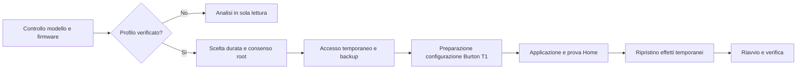

<div align="center">

# Fire TV Burton Activation

### Attiva la nuova Home ufficiale Amazon già presente sulla tua Fire TV

**Guida • Agent Skill • Workflow per Claude Code e Codex • Backup e ripristino**

[English](README.en.md) · [Compatibilità](skills/firetv-burton/references/compatibility.md) · [Guida completa](skills/firetv-burton/references/workflow.md) · [Ripristino](skills/firetv-burton/references/recovery.md)


[](https://github.com/vage88sg1/firetv-burton-activation/actions/workflows/checks.yml)

</div>

La nuova interfaccia **Amazon Fire TV**, conosciuta come **Burton**, può essere
già inclusa nel launcher ufficiale e restare disattivata per modello o rollout.
Questo progetto raccoglie un metodo verificato per abilitarla attraverso la sua
configurazione locale, con una skill che Claude Code o Codex può seguire.

**Risultato osservato:** nuova Home ufficiale attiva nel launcher Amazon originale,
navigazione funzionante e attivazione mantenuta dopo il riavvio. Il caso provato
usa Fire TV Stick 4K Max **prima generazione**, Fire OS **7.7.1.3 PS7713/5443**.
Non richiede un APK launcher modificato, un launcher alternativo o il flash del
firmware. L'accesso ai dati privati richiede però un tentativo di **root temporaneo**.

> **Leggi prima la compatibilità.** È un flusso sperimentale per dispositivi di
> proprietà: il passaggio root può bloccare o riavviare la Stick. È stato provato
> su un solo profilo preciso; gli altri modelli restano in modalità di analisi.

## Cosa trovi qui

| Risorsa | A cosa serve |
| --- | --- |
| [Skill `firetv-burton`](skills/firetv-burton/SKILL.md) | Dà a Claude/Codex contesto, controlli e sequenza operativa |
| [Workflow completo](skills/firetv-burton/references/workflow.md) | Dalla connessione ADB al riavvio finale, con verifiche intermedie |
| [Compatibilità ed evidenze](skills/firetv-burton/references/compatibility.md) | Spiega cosa funziona, cosa è fallito e perché |
| [Strumenti Python](skills/firetv-burton/scripts) | Controllo del dispositivo, preparazione offline e applicazione assistita |
| [Recupero e rollback](skills/firetv-burton/references/recovery.md) | Ripristino Home, aggiornamenti e impostazioni iniziali |
| [Workflow dichiarativo](workflow.json) | Fasi, requisiti e condizioni di arresto leggibili dagli agenti |
| [Controlli GitHub Actions](.github/workflows/checks.yml) | Test offline e verifica del contenuto pubblicato |

Gli script sono una confezione riutilizzabile del procedimento manuale verificato:
sono testati offline, **non qualificati con una seconda installazione automatica
completa su hardware**. Nessuno script o workflow CI avvia autonomamente l'exploit.

## Compatibilità verificata

| Dispositivo / software | Stato |
| --- | --- |
| Fire TV Stick 4K Max 1ª gen, **AFTKA / kara** | Provato |
| Fire OS **7.7.1.3**, **PS7713/5443** | Provato |
| Build incrementale **0035334210436** | Richiesta dal percorso root documentato |
| Launcher Amazon **7280112.1**, codice **728011210** | Burton attivato nella versione originale |
| Altri firmware, altre Stick, Fire TV Cube, Fire TV integrata | Non verificati; solo analisi iniziale |

Non basta leggere «Fire OS 7» o «4K Max» sulla confezione. Il controllo considera
anche build, kernel e architettura. Su un profilo diverso la procedura si ferma.

## Inizia con Claude Code o Codex

Clona il repository e aprilo nel tuo agente:

```sh
git clone https://github.com/vage88sg1/firetv-burton-activation.git
cd firetv-burton-activation
```

Poi incolla questa richiesta, sostituendo l'IP senza pubblicarlo:

```text
Leggi AGENTS.md e skills/firetv-burton/SKILL.md.
Voglio attivare la nuova Home ufficiale Amazon Burton sulla mia Fire TV.
Il dispositivo ADB è TV_IP:5555. Inizia con i controlli di sola lettura.
Verifica il profilo esatto, spiegami durata e protezione della configurazione,
e conserva un backup prima delle modifiche. Non ripetere tentativi root senza
una nuova autorizzazione informata. Alla fine ripristina gli effetti temporanei
e verifica la Home dopo il riavvio.
```

L'agente deve poter raggiungere la rete della TV e usare ADB sul computer locale.
Una sessione cloud o GitHub Actions non accede automaticamente alla tua Stick.
Accetta sulla TV soltanto l'autorizzazione del tuo computer.

### Installa la skill per riutilizzarla

La cartella è autonoma: include istruzioni, riferimenti e script. Puoi copiarla
nella posizione prevista dal tuo agente, partendo dalla radice del repository.
Verifica prima che non esista già una skill omonima da preservare.

**Codex:**

```sh
mkdir -p ~/.agents/skills
cp -R skills/firetv-burton ~/.agents/skills/firetv-burton
```

Invocazione: `$firetv-burton`.

**Claude Code:**

```sh
mkdir -p ~/.claude/skills
cp -R skills/firetv-burton ~/.claude/skills/firetv-burton
```

Invocazione: `/firetv-burton`.

Le posizioni sono documentate nelle guide ufficiali di
[Codex](https://developers.openai.com/codex/skills/) e
[Claude Code](https://code.claude.com/docs/en/skills).
Non servono chiavi API o un server MCP specifico del progetto.

## Primo controllo: nessuna modifica alla TV

Con Python 3.9+ e Android Platform Tools installati:

```sh
adb connect TV_IP:5555
python3 skills/firetv-burton/scripts/burton.py inspect --device TV_IP:5555
```

Il risultato indica se il dispositivo corrisponde al profilo provato. Questa
operazione non avvia root, non installa app e non cambia impostazioni.
Per proseguire usa la [guida completa](skills/firetv-burton/references/workflow.md).
Non saltare direttamente ai comandi root trovati in un altro progetto.

## Come funziona



Il launcher originale contiene sia la UI sia un meccanismo di override degli
esperimenti Amazon. Il procedimento modifica l'idoneità del modello e il
trattamento **T1** del solo esperimento Burton per il dispositivo scelto.
L'APK conserva firma e identità originali.

È possibile scegliere una scadenza lontana, per esempio **31 dicembre 2099**, e
sospendere il normale aggiornamento remoto del gruppo di configurazione Home.
Questa opzione congela anche gli altri parametri di quel gruppo: va scelta
consapevolmente. **Un nuovo firmware, un nuovo launcher o un ripristino dei dati
possono comunque sostituire la configurazione.** Non è una garanzia permanente
né un'iscrizione al rollout ufficiale Amazon.

## Perché non basta installare un APK più nuovo?

Nel caso studiato, il launcher ufficiale **7313002.1** si installava ma si chiudeva
per un componente del firmware mancante:

```text
NoSuchFieldError: AlexaExperience.SEARCH_ONLY
com.amazon.tv.ftvkarmalibrary
```

La versione Android e la firma corrette non garantiscono tutte le dipendenze.
Il metodo qui documentato attiva il codice già presente nella versione originale.
Non include APK Amazon, librerie estratte, chiavi di firma o firmware di altri modelli.

## Backup, privacy e ripristino

Tutti i dati reali vanno in `.local/`, esclusa da Git: backup, seriali, configurazioni,
log e binari scaricati. Il repository contiene solo codice originale, documentazione
ed esempi sintetici. Non serve condividere il seriale per chiedere assistenza.

Il root temporaneo scompare al riavvio; i suoi effetti su file e impostazioni
devono essere ripristinati prima. Il workflow lo prevede esplicitamente.
La [guida di recupero](skills/firetv-burton/references/recovery.md) spiega anche
come annullare il blocco della sincronizzazione preservando le impostazioni correnti.

## Test e contributi

```sh
python3 -m unittest discover -s tests -v
python3 tools/check_repository.py
```

I test usano dati sintetici e trasporti simulati: non cercano dispositivi e non
eseguono root. Per proporre un altro modello, porta evidenze compatibili con il
[modello di segnalazione](.github/ISSUE_TEMPLATE/compatibility.yml), senza allegare
backup o identificativi. Non basta cambiare un nome nel profilo.

## Fonti e licenza

La procedura di accesso temporaneo proviene dal lavoro di
[Delitants/GhostLock](https://github.com/Delitants/GhostLock/tree/5a9e2b08d0dca369df442c612a2693d3e7a771c6/kara)
e dal controller [firetv-kara-standalone](https://github.com/Delitants/firetv-kara-standalone).
Qui si aggiungono il flusso specifico per Burton, una patch dati verificata,
strumenti di preparazione e la skill per agenti. Attribuzioni e confini di
licenza sono in [THIRD_PARTY_NOTICES.md](THIRD_PARTY_NOTICES.md).

Il codice originale di questo repository è distribuito con [licenza MIT](LICENSE).
Progetto indipendente, non affiliato ad Amazon, Anthropic o OpenAI.

**Parole chiave:** Fire TV Stick nuovo launcher ufficiale, Amazon Fire TV new UI,
Burton launcher activation, Fire OS 7, AFTKA kara, Claude Code skill, Codex skill,
ADB, configurazione Home, temporary root, rollback.
